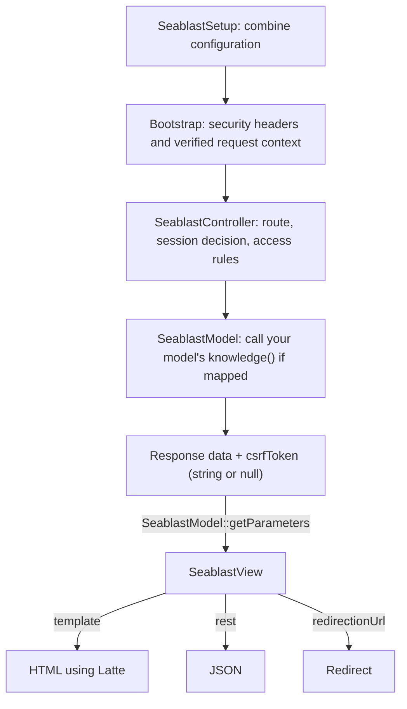

# Seablast Logic Overview

Seablast connects an incoming request to your application's logic and presentation through MVC.
Your application provides configuration, routes, models, and templates; the framework coordinates the request lifecycle.

Before constructing the runtime, the bootstrap locates the application, loads its autoloader, and initializes Tracy in production mode.

1. **SeablastSetup — configuration**: Combines framework defaults, optional package settings, and
   your application's and environment configuration into one `SeablastConfiguration`.

2. **SeablastController — request routing**: Prepares the request environment and cookie policy,
   selects an exact-path route from `SeablastConstant::APP_MAPPING`, decides whether a session is
   required, and enforces access through the configured identity manager. The route identifies your
   application's model and template.

3. **SeablastModel — application logic**: Creates the mapped application model with configuration
   and `Superglobals` (request and session data), then calls its `knowledge()` method. Your model
   performs the application logic and returns a `stdClass` containing response data. Seablast adds
   `csrfToken` (an active session token or null) and passes the object to the view through
   `getParameters()`. Routes without a model start with an empty object, so they can render a
   template without custom logic.

4. **SeablastView — response**: Uses the model's data to render the selected Latte template, with
   `configuration` and the request policy's `cspNonce` available to the template. Your model can
   instead set `rest` for a JSON response or `redirectionUrl` for a redirect, and optionally set
   `httpCode` for the response status. Use one response mode per result.

The diagram shows normal application flow. Bootstrap applies security headers and
validates one request-context snapshot before enabling Tracy development mode.
The controller shares that snapshot for host, HTTPS, client IP, and cookie decisions.
Request validation, maintenance, or access rules can stop processing or select an
error response. Session startup synchronizes `Superglobals` and reapplies headers;
models can request it explicitly before output. The view reapplies the same policy
and exposes SQL/HTTP diagnostic panels around response selection.

For practical application setup, see [AGENT-STARTER-KIT.md](../AGENT-STARTER-KIT.md).
For public configuration and response contracts, see [README.md](../README.md).
For maintenance invariants and verification, see [AGENTS.md](../AGENTS.md).
